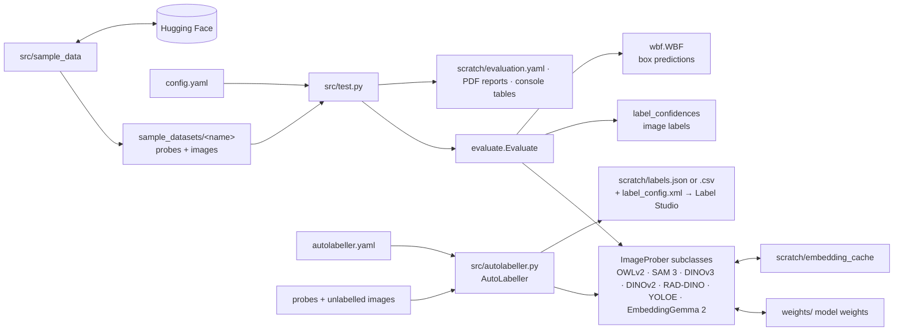

# autolabelling_via_embeddings

## Overview

**Purpose: automatic labelling of datasets for multi-label image problems.**
Given a few labelled examples of each class, the system decides which classes
are present in every unlabelled image, so a large image set can be labelled
from a handful of crops.

The labelled examples are **probes**: small crops each showing one object of a
known class. An image model scores every probe against every image ("is this
probe in this image?") and returns a probability, plus optional boxes. The
probabilities of a class's probes are combined into one confidence per image,
the mean of the best two (`topk_mean`, k = 2), and the image gets every
class whose confidence passes a threshold.

`python -m src.autolabeller` does this for any folder of probes and folder of
images, and writes the labels in a format Label Studio can import, for review
and correction.

The approach is evaluated on three small sample datasets from different
domains. Each has **20 labelled probes**, split evenly across its classes, and
**80 unlabelled images**. Hidden labels are kept for scoring only.

| Dataset | Domain | Classes |
|---|---|---|
| `coco_objects` | everyday photos (COCO) | 5: dog, cat, bicycle, bus, umbrella |
| `road_cracks` | road-surface photos (RDD2022) | 3: longitudinal, transverse and alligator cracks |
| `dental_xray` | panoramic dental X-rays (DENTEX) | 3: caries, periapical lesion, impacted tooth |

## Results

Per-image classification, as means over classes. Each cell gives the
threshold-tuned F1 / AUROC.

| Model | coco_objects | dental_xray | road_cracks |
|---|---|---|---|
| *every image positive* (baseline) | *0.387 / 0.500* | *0.723 / 0.500* | *0.678 / 0.500* |
| OWLv2 | 0.746 / 0.884 | 0.725 / 0.502 | 0.715 / 0.595 |
| SAM 3 | 0.786 / 0.924 | **0.751** / 0.557 | 0.686 / 0.548 |
| DINOv3 | 0.889 / 0.971 | 0.735 / 0.564 | 0.705 / **0.636** |
| DINOv2 | **0.903 / 0.976** | 0.727 / 0.520 | 0.717 / 0.633 |
| RAD-DINO (chest X-ray DINOv2) | 0.469 / 0.544 | 0.729 / 0.528 | 0.705 / 0.574 |
| YOLOE | 0.726 / 0.880 | 0.725 / 0.432 | 0.686 / 0.565 |
| EmbeddingGemma 2 | 0.841 / 0.939 | 0.748 / **0.632** | **0.720** / 0.600 |

How to read it:

- **Tuned F1** is the F1 at the threshold that maximises it for each class.
  It is fitted on the same images, so it is optimistic.
- **AUROC** does not depend on any threshold: it is the chance that a random
  image containing the class outscores a random one without it (0.5 = chance).
- **The baseline row** labels every image positive. It sets the F1 to beat,
  which is high when most images contain the class.

On everyday photos, the DINO models label images reliably (AUROC 0.97–0.98).
On road cracks they are only modestly better than chance. On dental X-rays no
model clearly beats the baseline, not even RAD-DINO, a DINOv2 trained on chest
X-rays. See [docs/evaluation.md](docs/evaluation.md)
for box-level results and the full analysis.

## Examples

Both examples use DINOv2 on `coco_objects` with eight of the dataset's
probes, two per class:

| dog | cat | bicycle | bus |
|---|---|---|---|
|   |   |   |   |
| probe1, probe2 | probe5, probe6 | probe9, probe10 | probe13, probe14 |

```python
import yaml
from src.evaluate import Evaluate
from src.image_prober_dinov2 import ImageProber_DINOv2
from src.wbf import WBF

config = yaml.safe_load(open("config.yaml"))
prober = ImageProber_DINOv2.from_config(config)
evaluator = Evaluate(WBF(**config["wbf"]), **config["evaluate"])   # label_method: topk_mean, k = 2

d = "sample_datasets/coco_objects/"
probes = {d + "probes/probe1.jpg": "dog", d + "probes/probe2.jpg": "dog",
          d + "probes/probe5.jpg": "cat", d + "probes/probe6.jpg": "cat",
          d + "probes/probe9.jpg": "bicycle", d + "probes/probe10.jpg": "bicycle",
          d + "probes/probe13.jpg": "bus", d + "probes/probe14.jpg": "bus"}
results = prober.image_probe([d + "images/image3.jpg", d + "images/image9.jpg"], list(probes))
for image, per_probe in results.items():
    print(image, evaluator.label_confidences(per_probe, probes))   # {label: confidence}
```

Each image is labelled with the classes whose confidence exceeds a threshold.
These examples use 0.5 for illustration; the evaluation tunes one threshold
per class.

### Example 1: a street scene with a bus and bicycles (`image3.jpg`, true labels: bicycle, bus)


| Class | Probe probabilities | Confidence (mean of top 2) | Label at 0.5 |
|---|---|---|---|
| dog | 0.038, 0.077 | 0.057 | no |
| cat | 0.017, 0.121 | 0.069 | no |
| bicycle | 0.301, 0.291 | 0.296 | **no (missed)** |
| bus | 0.991, 1.000 | **0.995** | **yes** |

The bus is found with near certainty by both bus probes. The bicycles score
only about 0.3, so at 0.5 this image would be labelled *bus* only.

### Example 2: a cat (`image9.jpg`, true label: cat)


| Class | Probe probabilities | Confidence (mean of top 2) | Label at 0.5 |
|---|---|---|---|
| dog | 0.427, 0.665 | 0.546 | **yes (wrong)** |
| cat | 0.997, 0.362 | **0.679** | **yes** |
| bicycle | 0.089, 0.161 | 0.125 | no |
| bus | 0.111, 0.075 | 0.093 | no |

One cat probe matches almost perfectly (0.997), but the other matches poorly
(0.362), which pulls the mean down. One dog probe also responds to the cat
(0.665), so *dog* is a false positive at 0.5.

Using all four probes per class and a separately tuned threshold per class
reduces such confusions; those are the settings behind the results table
above.

## Requirements

- Python 3.14, in the conda environment `auto`
- Pinned pip libraries: see `requirements.txt`
- NVIDIA GPU recommended (developed on an RTX 4090); CPU works but is slow
- Network access to huggingface.co, to rebuild the sample datasets and to download model weights once
- For SAM 3 and DINOv3 only: accept the licences at https://huggingface.co/facebook/sam3 and
  https://huggingface.co/facebook/dinov3-vitb16-pretrain-lvd1689m (both gated), then log in with `hf auth login`
- YOLOE uses `ultralytics`, which is AGPL-3.0 licensed

## Setup

```bash
conda create -n auto python=3.14   # skip if the env already exists
conda activate auto
pip install -r requirements.txt
git lfs install                    # once per machine; images are tracked via LFS
```

Model weights are downloaded into `weights/` the first time each model is
used, then reused.

## How to run

Run all commands from the project root.

```bash
python -m src.autolabeller                            # label images for Label Studio (options: autolabeller.yaml)
python -m src.test                                    # evaluate every model on every dataset; tables + reports
python -m src.test --models dinov2 --datasets coco_objects   # a subset
python -m src.sample_data                             # (re)build the sample datasets
python -m src.image_prober_dinov2                     # per-probe evaluation of one model (any prober module)
```

`python -m src.test` writes `scratch/evaluation.yaml` and PDF reports to
`scratch/`, then prints the result tables. Embeddings are cached in
`scratch/embedding_cache/`, so repeat runs take about two minutes.

## Programs and command-line parameters

### `python -m src.autolabeller`

Labels every image in `images_dir` from the labelled probes in `probes_dir`
(labels from `probes_yaml`, or from sub-folder names), using one model and
one probe-combining method. Writes `scratch/labels.json`: Label Studio tasks
with the labels as pre-annotations and per-class confidences. It also writes a
matching `scratch/label_config.xml` labelling interface. With an `output`
ending in `.csv`, it writes one row per image instead. All options are in
`autolabeller.yaml`; by default it labels the `coco_objects` images with
DINOv2. Options and Label Studio import steps:
[docs/autolabeller.md](docs/autolabeller.md).

| Flag       | Type | Required | Default             | Description          |
|------------|------|----------|---------------------|----------------------|
| `--config` | path | no       | `autolabeller.yaml` | Options file to read |

```bash
python -m src.autolabeller                              # defaults: coco_objects, dinov2, scratch/labels.json
python -m src.autolabeller --config my_project.yaml     # your own probes, images, model and output
```

### `python -m src.test`

Runs every model in `test.models` on every sample dataset. It reports image
labelling (baseline F1, tuned F1 and AUROC per class) and box predictions
(box AP at IoU 0.25), writes `scratch/evaluation.yaml` and PDF reports, and
prints the tables at the end. Each run first deletes the previous run's
results. Details: [docs/evaluation.md](docs/evaluation.md).

| Flag         | Type     | Required | Default       | Description                              |
|--------------|----------|----------|---------------|------------------------------------------|
| `--config`   | path     | no       | `config.yaml` | Config file to read                      |
| `--models`   | names... | no       | `test.models` | Models to evaluate: `owlv2`, `sam3`, `dinov3`, `dinov2`, `raddino`, `yoloe`, `embeddinggemma2` |
| `--datasets` | names... | no       | all           | Datasets to evaluate                     |

### `python -m src.sample_data`

Builds the sample datasets from public sources on Hugging Face. Details:
[docs/sample_datasets.md](docs/sample_datasets.md).

| Flag       | Type     | Required | Default       | Description                    |
|------------|----------|----------|---------------|--------------------------------|
| `--config` | path     | no       | `config.yaml` | Config file to read            |
| `--only`   | names... | no       | all           | Build only these datasets      |

### `python -m src.image_prober_<model>`

Evaluates one model's raw per-probe output on the sample datasets. Details:
[docs/models.md](docs/models.md).

| Flag         | Type     | Required | Default       | Description                  |
|--------------|----------|----------|---------------|------------------------------|
| `--config`   | path     | no       | `config.yaml` | Config file to read          |
| `--datasets` | names... | no       | all           | Evaluate only these datasets |

Model and evaluation settings live in `config.yaml`, one section per module;
see [docs/configuration.md](docs/configuration.md). The autolabeller's
options live in `autolabeller.yaml`.

## System diagram



## Project layout

```
.
├── README.md
├── docs/              # technical documentation: models, evaluation, datasets, configuration
├── config.yaml        # model and evaluation parameters, one subsection per module
├── autolabeller.yaml  # autolabeller options: probes, images, model, combining, thresholds, output
├── requirements.txt   # pinned pip dependencies
├── src/
│   ├── autolabeller.py          # AutoLabeller: label images from probes, export for Label Studio
│   ├── image_prober.py          # ImageProber base class (public API, caching, weights, model registry)
│   ├── image_prober_*.py        # one module per model
│   ├── evaluate.py              # Evaluate: image labelling and box metrics
│   ├── wbf.py                   # WBF: weighted boxes fusion for box predictions
│   ├── test.py                  # evaluation of every model on every dataset
│   └── sample_data/             # builder for the sample datasets
├── sample_datasets/   # the three sample datasets (probes + images)
├── scratch/           # generated output (git-ignored)
└── weights/           # downloaded model weights and data cache (git-ignored)
```
