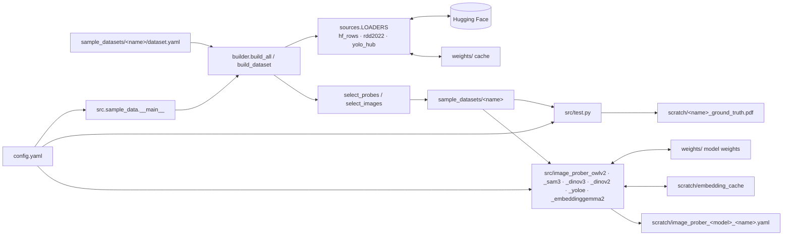
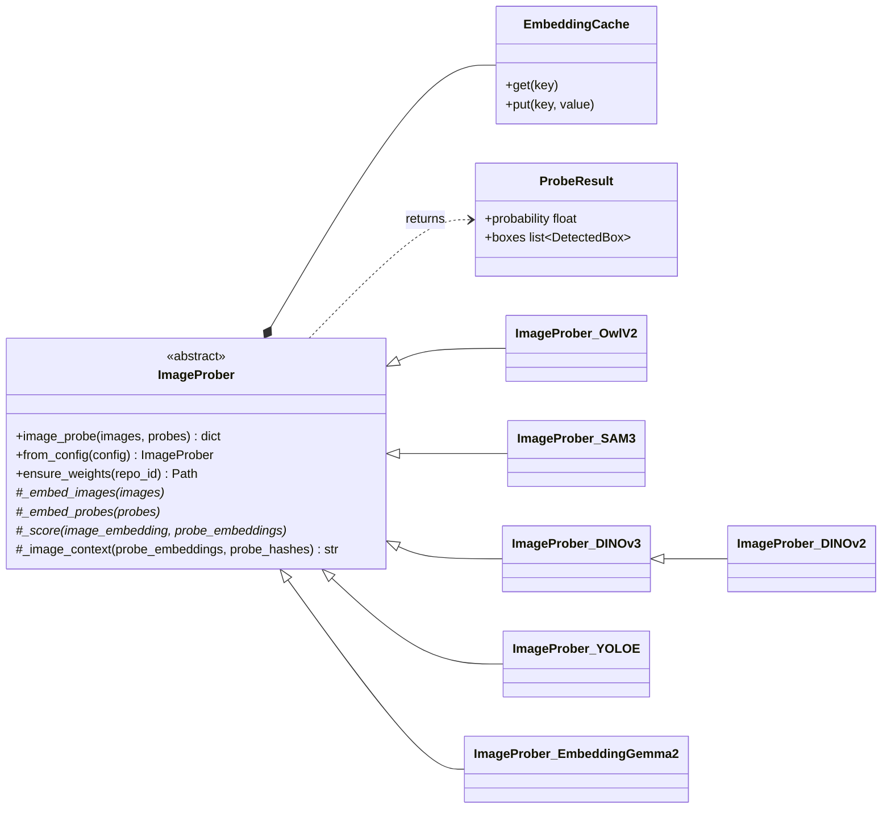

# autolabelling_via_embeddings

## Overview

Multi-label automatic labelling of images using embeddings. A small set of labelled
*probes* (crops of single objects) is searched for in unlabelled full images; each
image is labelled with the probe classes found in it.

## Requirements

- Python 3.14
- Conda environment `auto`
- Pinned pip libraries: see `requirements.txt`
- NVIDIA GPU recommended (developed on an RTX 4090); CPU works but is slow
- Network access to huggingface.co (to rebuild the sample datasets, and to download model weights once)
- For SAM 3 and DINOv3 only: accept the licences at https://huggingface.co/facebook/sam3 and
  https://huggingface.co/facebook/dinov3-vitb16-pretrain-lvd1689m (both gated), then log in with `hf auth login`
- YOLOE uses `ultralytics`, which is AGPL-3.0 licensed

## Setup

```bash
conda create -n auto python=3.14   # skip if the env already exists
conda activate auto
pip install -r requirements.txt
git lfs install                    # once per machine; images are tracked via LFS
```

## How to run

Run all commands from the project root.

```bash
python -m src.sample_data                        # (re)build all sample datasets
python -m src.sample_data --only road_cracks     # rebuild one dataset
python src/test.py                               # render ground-truth PDFs to scratch/
python -m src.image_prober_owlv2                 # evaluate OWLv2 on all sample datasets
python -m src.image_prober_sam3 --datasets coco_objects   # evaluate SAM 3 on one dataset
python -m src.image_prober_dinov3                # evaluate DINOv3 patch matching
python -m src.image_prober_dinov2                # evaluate DINOv2 patch matching (ungated)
python -m src.image_prober_yoloe                 # evaluate YOLOE visual prompts
python -m src.image_prober_embeddinggemma2       # evaluate EmbeddingGemma 2 tile retrieval
```

From Python:

```python
import yaml
from src.image_prober_owlv2 import ImageProber_OwlV2

prober = ImageProber_OwlV2.from_config(yaml.safe_load(open("config.yaml")))
results = prober.image_probe(["a.jpg", "b.jpg"], ["probe1.jpg", "probe2.jpg"])
results["a.jpg"]["probe1.jpg"].probability   # float in [0, 1]
results["a.jpg"]["probe1.jpg"].boxes         # [DetectedBox(x0, y0, x1, y1, score), ...]
```

Sample datasets are written to `sample_datasets/`. Downloads and model weights are
cached in `weights/`; weights are downloaded once and reused on every later run.
Other generated output, including the embedding cache, goes to `scratch/`.

## Programs and command-line parameters

### `python -m src.sample_data`

Builds every folder under `sample_datasets/` that contains a `dataset.yaml`.
It downloads the public detection dataset named there from Hugging Face, picks
probe crops and full images, and writes them into the same folder. Probes are cropped
from source images that are never used as dataset images. Each run replaces the
generated files (`probes/`, `images/`, `probes.yaml`, `images.yaml`) and leaves
`dataset.yaml` untouched.

| Flag       | Type      | Required | Default       | Description                     |
|------------|-----------|----------|---------------|---------------------------------|
| `--config` | path      | no       | `config.yaml` | Config file to read             |
| `--only`   | names...  | no       | all           | Build only these dataset names  |

Reads `general.weights_dir` and `sample_data.datasets_dir` from `config.yaml`, plus each dataset's `dataset.yaml`.

### `python src/test.py`

Reads each dataset's `images.yaml` and draws the ground-truth boxes and labels
on its images. Writes one PDF per dataset, one image per page, to
`scratch/<name>_ground_truth.pdf`. Each PDF opens with a cover page that
summarises all sample datasets side by side, with the PDF's own dataset shaded.
For each dataset it shows image, box and probe totals, background (no-label)
and multi-label image counts, and boxes per image. A per-class table gives box
count, support (images containing the class), image coverage (support as a %
of images) and probe count.

| Flag       | Type | Required | Default       | Description         |
|------------|------|----------|---------------|---------------------|
| `--config` | path | no       | `config.yaml` | Config file to read |

Reads the `general`, `sample_data` (for `datasets_dir`) and `test` sections of `config.yaml`.

### Image probers: `python -m src.image_prober_<model>` (`owlv2`, `sam3`, `dinov3`, `dinov2`, `yoloe`, `embeddinggemma2`)

An image prober answers "is probe *i* in image *j*, and where?" for every
pair. `ImageProber.image_probe(images, probes)` takes N images and M probes,
either file paths or PIL images, and returns `{image: {probe: ProbeResult}}`.
Each `ProbeResult` holds a `probability` and a list of `boxes` in the image's
pixel coordinates. Keys are the input paths as strings, or list indexes for
in-memory images.

For most probers, each image and each probe goes through the model's
expensive vision encoder once, so a call costs about N + M encoder passes
rather than N × M. Embeddings are cached in memory and on disk, keyed by
image content, so repeat runs skip the encoder entirely. Two exceptions:
SAM 3 draws the probes onto each image, so its image embeddings are cached
per probe set; EmbeddingGemma 2 gives one vector per input, so each image
costs one embedding per tile (about 20–50).

| Prober              | Model                                   | Per (image, probe) cost                    |
|---------------------|-----------------------------------------|--------------------------------------------|
| `ImageProber_OwlV2` | OWLv2 image-guided detection            | one matrix product over patches (cheap)    |
| `ImageProber_SAM3`  | SAM 3; each image drawn above a strip of probe tiles, each tile boxed as a same-image exemplar | DETR encoder/decoder pass, batched over probes |
| `ImageProber_DINOv3` | DINOv3 patch features vs. probe prototype, training-free | one matrix product over patches (cheap) |
| `ImageProber_DINOv2` | as DINOv3, with DINOv2 weights (ungated) | one matrix product over patches (cheap) |
| `ImageProber_YOLOE` | YOLOE, probe crop as a visual prompt    | one detection-head pass per image, all probes at once |
| `ImageProber_EmbeddingGemma2` | EmbeddingGemma 2 vectors of multi-scale image tiles vs. the probe | one matrix product over tiles (cheap) |

Results on the sample datasets (mean over classes; AP / ROC AUC; uncached
time per dataset of 80 images × 20 probes on an RTX 4090):

| Prober | coco_objects | road_cracks | dental_xray | Time |
|--------|--------------|-------------|-------------|------|
| DINOv2 (base) | **0.936 / 0.975** | **0.671** / **0.646** | 0.638 / 0.502 | ~5 s |
| DINOv3 (ViT-B/16) | 0.928 / 0.966 | 0.614 / 0.607 | 0.641 / 0.561 | ~10 s |
| EmbeddingGemma 2 | 0.851 / 0.915 | 0.614 / 0.637 | **0.689 / 0.642** | 100–210 s |
| SAM 3 (canvas) | 0.804 / 0.919 | 0.560 / 0.537 | 0.584 / 0.545 | ~15 s |
| OWLv2 (base) | 0.735 / 0.844 | 0.607 / 0.591 | 0.633 / 0.534 | ~6 s |
| YOLOE (11l-seg) | 0.690 / 0.866 | 0.592 / 0.570 | 0.556 / 0.438 | ~2 s |

AP on `dental_xray` should be read against its high label prevalence (most
images contain caries), so the AUC is the more telling number there.
Probability calibrations were set by eye on `coco_objects` and need refitting
for other domains.

Run as a program, each prober is evaluated on every sample dataset.
It prints per-class AP, ROC AUC, best F1 (with its threshold) and box recall,
plus the number of passes and the time taken. A class's score for an image is
its best-scoring probe's probability. The full per-pair results go to
`scratch/image_prober_<model>_<dataset>.yaml`.

| Flag         | Type     | Required | Default       | Description                    |
|--------------|----------|----------|---------------|--------------------------------|
| `--config`   | path     | no       | `config.yaml` | Config file to read            |
| `--datasets` | names... | no       | all           | Evaluate only these datasets   |

Reads `general`, `sample_data`, `image_prober`, `image_prober_eval` and the model's own section.

## Sample datasets

| Name           | Source                                   | Labels                                                   | License        |
|----------------|------------------------------------------|----------------------------------------------------------|----------------|
| `coco_objects` | COCO val2017 (`rafaelpadilla/coco2017`)  | dog, cat, bicycle, bus, umbrella                         | CC BY 4.0      |
| `road_cracks`  | RDD2022 (`dronefreak/RDD2022`)           | longitudinal_crack, transverse_crack, alligator_crack    | CC BY-SA 4.0   |
| `dental_xray`  | DENTEX (`liodon-ai/dental-panoramic-xray-yolo`) | caries, periapical_lesion, impacted_tooth         | CC BY 4.0      |

Each dataset has 20 probes (split evenly across labels) and 80 images drawn to
cover many label combinations. About 10% of images contain none of the labels where
the source has such images (`dental_xray` has none). Every image is resized to
1280 px wide, keeping its aspect ratio. Probes are cropped from source images
resized the same way, so probes and images share one scale.

Each dataset folder is self-contained. To add one, create a folder holding a
`dataset.yaml` and run the builder. To remove one, delete its folder.

```
sample_datasets/<name>/
  dataset.yaml        # hand-written build settings: source, labels, counts, image width, seed
  probes.yaml         # labels list; per probe: file, label, source_id, source_bbox_xywh
  probes/probeN.jpg   # labelled object crops
  images/imageN.jpg   # full, unlabelled images
  images.yaml         # hidden per-image labels and boxes, for evaluation only
```

## Configuration

All key parameters live in `config.yaml`, with one subsection per module.

| Section       | Key                 | Description                                              |
|---------------|---------------------|----------------------------------------------------------|
| `general`     | `output_dir`        | Directory for generated output                           |
| `general`     | `weights_dir`       | Directory for transient downloaded data                  |
| `general`     | `random_seed`       | Seed for reproducible runs                               |
| `sample_data` | `datasets_dir`      | Folder of sample datasets (each sub-folder with a `dataset.yaml`) |
| `test`        | `pdf_suffix`        | Suffix for PDF names (`<name><suffix>.pdf`)              |
| `test`        | `page_size`         | Fixed page size (px); images are fitted and centred. 32:9 fills about half a 16:9 screen at fit-to-width |
| `test`        | `line_width`        | Box outline width (px)                                   |
| `test`        | `font_size`         | Label and header text size (px)                          |
| `test`        | `cover_font_size`   | Text size on the summary cover page (px)                 |
| `test`        | `dpi`               | PDF resolution                                           |
| `image_prober` | `device`           | `auto` (CUDA if available), `cuda` or `cpu`              |
| `image_prober` | `batch_size`       | Images or probes per encoder pass                        |
| `image_prober` | `memory_cache_items` | Embeddings kept in memory (LRU)                        |
| `image_prober` | `cache_dir`        | On-disk embedding cache; `null` disables it              |
| `image_prober_eval` | `box_iou`     | IoU for a returned box to count as a ground-truth hit    |
| `image_prober_owlv2` | `repo_id`    | Hugging Face model (base or large OWLv2)                 |
| `image_prober_owlv2` | `logit_offset`, `logit_temperature` | Calibration: `sigmoid((logit - offset) / temperature)`; image queries otherwise saturate near 1 |
| `image_prober_owlv2` | `query_iou_fraction` | Probe query: highest-objectness box among those near the best overlap with the probe |
| `image_prober_sam3` | `exemplar_mode` | `canvas` (probes tiled under each image; default) or `transfer` (probe tokens from their own frame; ~chance) |
| `image_prober_sam3` | `strip_columns`, `max_strip_fraction` | Canvas: tiles per strip row; max share of canvas height for the strip (more probes use more canvases) |
| `image_prober_sam3` | `probe_batch_size` | Probes per DETR encoder/decoder pass                 |
| `image_prober_dinov3`, `image_prober_dinov2` | `repo_id` | DINO checkpoint (DINOv3 gated; DINOv2 open); both sections take the keys below |
| `image_prober_dinov3` | `image_size`, `probe_size` | Longer side of images / probes fed to the backbone |
| `image_prober_dinov3` | `probe_border`, `top_k` | Probe margin trimmed before averaging; presence = mean of the best k patch similarities |
| `image_prober_dinov3` | `sim_offset`, `sim_temperature` | Calibration: `sigmoid((similarity - offset) / temperature)` |
| `image_prober_yoloe` | `weights_file` | Ultralytics YOLOE asset with a prompt-able NMS head (e.g. `yoloe-11l-seg.pt`) |
| `image_prober_yoloe` | `imgsz`, `probe_size` | Letterbox size; longer side of a probe on its canvas (smaller probes match better) |
| `image_prober_embeddinggemma2` | `embedding_dim` | Matryoshka size: 768, 512, 256 or 128 |
| `image_prober_embeddinggemma2` | `tile_scales`, `tile_overlap`, `tile_batch_size` | Tile sides as fractions of the shorter image side (whole image always included); overlap; tiles per pass |
| `image_prober_embeddinggemma2` | `sim_offset`, `sim_temperature` | Calibration: `sigmoid((similarity - offset) / temperature)` |
| `image_prober_sam3` | `probability` | `max_score` (best query × presence) or `presence` only  |
| all model sections | `dtype`, `box_threshold`, `nms_iou`, `max_boxes` | GPU precision; box score threshold, suppression overlap (not DINO) and cap |

### `dataset.yaml` (per sample dataset)

| Key                 | Description                                                         |
|---------------------|---------------------------------------------------------------------|
| `source`            | Loader: `hf_rows`, `rdd2022` or `yolo_hub`, plus its own keys (`dataset`, `split`, ...) |
| `labels`            | Source category names to keep; `label_map` optionally renames them  |
| `license`           | License recorded in the generated YAML files                        |
| `num_probes`        | Probe crops, split evenly across labels                             |
| `num_images`        | Full images                                                         |
| `image_width`       | Width (px) every image is resized to, keeping aspect ratio          |
| `negative_fraction` | Share of images with none of the labels                             |
| `probe_padding`     | Context around probe boxes (fraction of box size)                   |
| `probe_min_side`    | Min shorter side of a probe box, in source-image pixels             |
| `jpeg_quality`      | JPEG quality for images and probe crops                             |
| `seed`              | Random seed for reproducible selection                              |

## System diagram





## Project layout

```
.
├── config.yaml        # all parameters, one subsection per module
├── requirements.txt   # pinned pip dependencies
├── src/
│   ├── sample_data/            # builder for the sample datasets
│   ├── image_prober.py         # ImageProber base class, cache, evaluation CLI
│   ├── image_prober_owlv2.py   # ImageProber_OwlV2
│   ├── image_prober_sam3.py    # ImageProber_SAM3
│   ├── image_prober_dinov3.py  # ImageProber_DINOv3
│   ├── image_prober_dinov2.py  # ImageProber_DINOv2 (DINOv3 method, DINOv2 weights)
│   ├── image_prober_yoloe.py   # ImageProber_YOLOE
│   ├── image_prober_embeddinggemma2.py  # ImageProber_EmbeddingGemma2
│   └── test.py                 # renders ground-truth PDFs for visual checks
├── sample_datasets/   # generated sample datasets (probes + images)
├── scratch/           # generated output (git-ignored)
├── weights/           # transient downloaded data: model weights, dataset cache (git-ignored)
└── README.md
```
