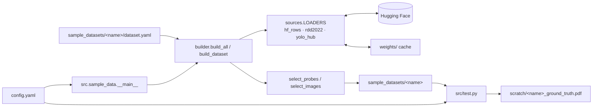

# autolabelling_via_embeddings

## Overview

Multi-label automatic labelling of images using embeddings. A small set of labelled
*probes* (crops of single objects) is searched for in unlabelled full images; each
image is labelled with the probe classes found in it.

## Requirements

- Python 3.14
- Conda environment `auto`
- Pinned pip libraries: see `requirements.txt`
- Network access to huggingface.co (only needed to rebuild the sample datasets)

## Setup

```bash
conda create -n auto python=3.14   # skip if the env already exists
conda activate auto
pip install -r requirements.txt
git lfs install                    # once per machine; images are tracked via LFS
```

## How to run

Run all commands from the project root.

```bash
python -m src.sample_data                        # (re)build all sample datasets
python -m src.sample_data --only road_cracks     # rebuild one dataset
python src/test.py                               # render ground-truth PDFs to scratch/
```

Sample datasets are written to `sample_datasets/`; downloads are cached in `weights/`.
Other generated output goes to `scratch/`.

## Programs and command-line parameters

### `python -m src.sample_data`

Builds every folder under `sample_datasets/` that contains a `dataset.yaml`.
It downloads the public detection dataset named there from Hugging Face, picks
probe crops and full images, and writes them into the same folder. Probes are cropped
from source images that are never used as dataset images. Each run replaces the
generated files (`probes/`, `images/`, `probes.yaml`, `images.yaml`) and leaves
`dataset.yaml` untouched.

| Flag       | Type      | Required | Default       | Description                     |
|------------|-----------|----------|---------------|---------------------------------|
| `--config` | path      | no       | `config.yaml` | Config file to read             |
| `--only`   | names...  | no       | all           | Build only these dataset names  |

Reads `general.weights_dir` and `sample_data.datasets_dir` from `config.yaml`, plus each dataset's `dataset.yaml`.

### `python src/test.py`

Reads each dataset's `images.yaml` and draws the ground-truth boxes and labels
on its images. Writes one PDF per dataset, one image per page, to
`scratch/<name>_ground_truth.pdf`.

| Flag       | Type | Required | Default       | Description         |
|------------|------|----------|---------------|---------------------|
| `--config` | path | no       | `config.yaml` | Config file to read |

Reads the `general`, `sample_data` (for `datasets_dir`) and `test` sections of `config.yaml`.

## Sample datasets

| Name           | Source                                   | Labels                                                   | License        |
|----------------|------------------------------------------|----------------------------------------------------------|----------------|
| `coco_objects` | COCO val2017 (`rafaelpadilla/coco2017`)  | dog, cat, bicycle, bus, umbrella                         | CC BY 4.0      |
| `road_cracks`  | RDD2022 (`dronefreak/RDD2022`)           | longitudinal_crack, transverse_crack, alligator_crack    | CC BY-SA 4.0   |
| `dental_xray`  | DENTEX (`liodon-ai/dental-panoramic-xray-yolo`) | caries, periapical_lesion, impacted_tooth         | CC BY 4.0      |

Each dataset has 20 probes (split evenly across labels) and 80 images drawn to
cover many label combinations. About 10% of images contain none of the labels where
the source has such images (`dental_xray` has none). Every image is resized to
1280 px wide, keeping its aspect ratio. Probes are cropped from source images
resized the same way, so probes and images share one scale.

Each dataset folder is self-contained. To add one, create a folder holding a
`dataset.yaml` and run the builder. To remove one, delete its folder.

```
sample_datasets/<name>/
  dataset.yaml        # hand-written build settings: source, labels, counts, image width, seed
  probes.yaml         # labels list; per probe: file, label, source_id, source_bbox_xywh
  probes/probeN.jpg   # labelled object crops
  images/imageN.jpg   # full, unlabelled images
  images.yaml         # hidden per-image labels and boxes, for evaluation only
```

## Configuration

All key parameters live in `config.yaml`, with one subsection per module.

| Section       | Key                 | Description                                              |
|---------------|---------------------|----------------------------------------------------------|
| `general`     | `output_dir`        | Directory for generated output                           |
| `general`     | `weights_dir`       | Directory for transient downloaded data                  |
| `general`     | `random_seed`       | Seed for reproducible runs                               |
| `sample_data` | `datasets_dir`      | Folder of sample datasets (each sub-folder with a `dataset.yaml`) |
| `test`        | `pdf_suffix`        | Suffix for PDF names (`<name><suffix>.pdf`)              |
| `test`        | `page_size`         | Fixed page size (px); images are fitted and centred. 32:9 fills about half a 16:9 screen at fit-to-width |
| `test`        | `line_width`        | Box outline width (px)                                   |
| `test`        | `font_size`         | Label and header text size (px)                          |
| `test`        | `dpi`               | PDF resolution                                           |

### `dataset.yaml` (per sample dataset)

| Key                 | Description                                                         |
|---------------------|---------------------------------------------------------------------|
| `source`            | Loader: `hf_rows`, `rdd2022` or `yolo_hub`, plus its own keys (`dataset`, `split`, ...) |
| `labels`            | Source category names to keep; `label_map` optionally renames them  |
| `license`           | License recorded in the generated YAML files                        |
| `num_probes`        | Probe crops, split evenly across labels                             |
| `num_images`        | Full images                                                         |
| `image_width`       | Width (px) every image is resized to, keeping aspect ratio          |
| `negative_fraction` | Share of images with none of the labels                             |
| `probe_padding`     | Context around probe boxes (fraction of box size)                   |
| `probe_min_side`    | Min shorter side of a probe box, in source-image pixels             |
| `jpeg_quality`      | JPEG quality for images and probe crops                             |
| `seed`              | Random seed for reproducible selection                              |

## System diagram



## Project layout

```
.
├── config.yaml        # all parameters, one subsection per module
├── requirements.txt   # pinned pip dependencies
├── src/
│   ├── sample_data/   # builder for the sample datasets
│   └── test.py        # renders ground-truth PDFs for visual checks
├── sample_datasets/   # generated sample datasets (probes + images)
├── scratch/           # generated output (git-ignored)
├── weights/           # transient downloaded data, e.g. model weights (git-ignored)
└── README.md
```
