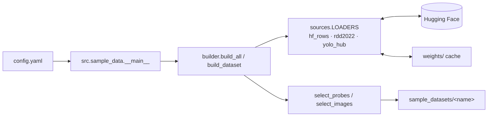

# autolabelling_via_embeddings

## Overview

Multi-label automatic labelling of images using embeddings. A small set of labelled
*probes* (crops of single objects) is searched for in unlabelled full images; each
image is labelled with the probe classes found in it.

## Requirements

- Python 3.14
- Conda environment `auto`
- Pinned pip libraries: see `requirements.txt`
- Network access to huggingface.co (only needed to rebuild the sample datasets)

## Setup

```bash
conda create -n auto python=3.14   # skip if the env already exists
conda activate auto
pip install -r requirements.txt
git lfs install                    # once per machine; images are tracked via LFS
```

## How to run

Run all commands from the project root.

```bash
python -m src.sample_data                        # (re)build all sample datasets
python -m src.sample_data --only road_cracks     # rebuild one dataset
```

Sample datasets are written to `sample_datasets/`; downloads are cached in `weights/`.
Other generated output goes to `scratch/`.

## Programs and command-line parameters

### `python -m src.sample_data`

Downloads public detection datasets from Hugging Face, picks probe crops and
full images, and writes them to `sample_datasets/<name>/`. Probes are cropped from
source images that are never used as dataset images. Each run replaces the folders
it builds.

| Flag       | Type      | Required | Default       | Description                     |
|------------|-----------|----------|---------------|---------------------------------|
| `--config` | path      | no       | `config.yaml` | Config file to read             |
| `--only`   | names...  | no       | all           | Build only these dataset names  |

Reads the `general` and `sample_data` sections of `config.yaml`.

## Sample datasets

| Name           | Source                                   | Labels                                                   | License        |
|----------------|------------------------------------------|----------------------------------------------------------|----------------|
| `coco_objects` | COCO val2017 (`rafaelpadilla/coco2017`)  | dog, cat, bicycle, bus, umbrella                         | CC BY 4.0      |
| `road_cracks`  | RDD2022 (`dronefreak/RDD2022`)           | longitudinal_crack, transverse_crack, alligator_crack    | CC BY-SA 4.0   |
| `dental_xray`  | DENTEX (`liodon-ai/dental-panoramic-xray-yolo`) | caries, periapical_lesion, impacted_tooth         | CC BY 4.0      |

Each dataset has 20 probes (split evenly across labels) and 80 images drawn to
cover many label combinations. About 10% of images contain none of the labels where
the source has such images. `dental_xray` has none, and its panoramic images are
downscaled to a maximum side of 1600 px.

```
sample_datasets/<name>/
  probes.yaml         # labels list; per probe: file, label, source_id, bbox_xywh
  probes/probeN.jpg   # labelled object crops
  images/imageN.jpg   # full, unlabelled images
  images.yaml         # hidden per-image labels and boxes, for evaluation only
```

## Configuration

All key parameters live in `config.yaml`, with one subsection per module.

| Section       | Key                 | Description                                              |
|---------------|---------------------|----------------------------------------------------------|
| `general`     | `output_dir`        | Directory for generated output                           |
| `general`     | `weights_dir`       | Directory for transient downloaded data                  |
| `general`     | `random_seed`       | Seed for reproducible runs                               |
| `sample_data` | `output_dir`        | Where sample datasets are written                        |
| `sample_data` | `cache_dir`         | Download cache for source annotations and images         |
| `sample_data` | `num_probes`        | Probes per dataset                                       |
| `sample_data` | `num_images`        | Images per dataset                                       |
| `sample_data` | `negative_fraction` | Share of images with none of the labels                  |
| `sample_data` | `probe_padding`     | Context around probe boxes (fraction of box size)        |
| `sample_data` | `probe_min_side`    | Min box side (px) for a probe; per-dataset override      |
| `sample_data` | `jpeg_quality`      | JPEG quality for crops and re-encoded images             |
| `sample_data` | `datasets.<name>`   | Per-dataset source (`hf_rows`, `rdd2022`, `yolo_hub`), labels, renames |

## System diagram



## Project layout

```
.
├── config.yaml        # all parameters, one subsection per module
├── requirements.txt   # pinned pip dependencies
├── src/
│   └── sample_data/   # builder for the sample datasets
├── sample_datasets/   # generated sample datasets (probes + images)
├── scratch/           # generated output (git-ignored)
├── weights/           # transient downloaded data, e.g. model weights (git-ignored)
└── README.md
```
