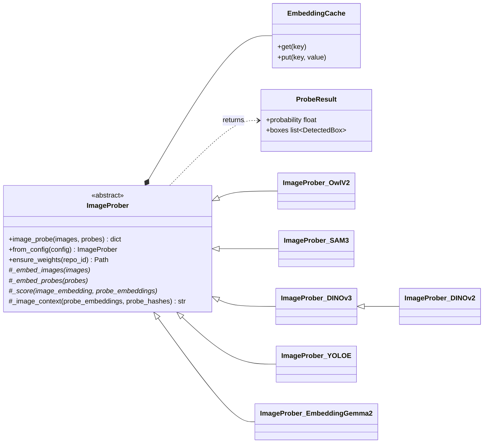

# Image probers (models)

An image prober answers "is probe *i* in image *j*, and where?" for every
(image, probe) pair. Every model implements the same abstract interface,
`ImageProber` in `src/image_prober.py`, so evaluation and labelling code work
with any of them.

## Public interface

```python
results = prober.image_probe(images, probes)   # N images, M probes (paths or PIL images)
results[image][probe].probability               # float in [0, 1]
results[image][probe].boxes                     # [DetectedBox(x0, y0, x1, y1, score), ...] in image pixels
```

Result keys are the input paths as strings, or list indexes for in-memory
images. A prober is built from `config.yaml` with `ProberClass.from_config(config)`.
That reads the shared `image_prober` section plus the model's own section.

The base class provides the shared machinery:

- **Weights**: downloaded once into `weights/<org>--<name>/`. A marker file
  records a finished download, so later runs never download again, and an
  interrupted download is retried.
- **Embedding cache**: an in-memory LRU, backed by `.pt` files in
  `scratch/embedding_cache/` and keyed by model settings and image content.
  An image or probe is embedded at most once.
- **Batching**: for most probers the expensive vision encoder runs once per
  image and once per probe, so a call costs about N + M encoder passes rather
  than N × M.
- **`_image_context` hook**: lets a prober whose image embeddings depend on
  the probe set (SAM 3) key its cache by that set.

Subclasses implement `_embed_images`, `_embed_probes`, `_score` and `cache_tag`.



## The models

| Prober | Module | Model | Boxes | Cost per (image, probe) |
|---|---|---|---|---|
| `ImageProber_OwlV2` | `image_prober_owlv2.py` | OWLv2 base, image-guided detection (Apache-2.0) | native | one matrix product over patches |
| `ImageProber_SAM3` | `image_prober_sam3.py` | SAM 3 (gated) | native | one DETR encoder/decoder pass, batched over probes |
| `ImageProber_DINOv3` | `image_prober_dinov3.py` | DINOv3 ViT-B/16 (gated) | from patch regions | one matrix product over patches |
| `ImageProber_DINOv2` | `image_prober_dinov2.py` | DINOv2 base (Apache-2.0) | from patch regions | one matrix product over patches |
| `ImageProber_YOLOE` | `image_prober_yoloe.py` | YOLOE-11L-seg (AGPL-3.0) | native | one detection-head pass per image, all probes at once |
| `ImageProber_EmbeddingGemma2` | `image_prober_embeddinggemma2.py` | EmbeddingGemma 2 (Apache-2.0) | tile boxes | one matrix product over tiles |

### OWLv2

OWLv2 predicts a box and a class embedding for every image patch. The boxes
don't depend on the query, so each image and probe needs one pass. A probe's
query embedding comes from the patch whose predicted box best covers the
probe: among boxes close to the best overlap with the probe's extent, the one
with the highest objectness.

Image-derived queries saturate OWLv2's sigmoid, so patch logits are
calibrated as `sigmoid((logit - offset) / temperature)`. The offset was set
by eye on `coco_objects`.

### SAM 3

SAM 3 only accepts an exemplar as a box drawn on the image being searched,
and it is trained only that way. Its presence head therefore assumes that an
exemplar means the concept is present.

- **Moving encoded probe tokens to another image (`exemplar_mode: transfer`)
  fails.** Presence comes out at about 1.0 for every image, giving chance-level
  results.
- **The default, `canvas`, draws each image above a strip of probe tiles.**
  Each tile is boxed as a genuine same-image exemplar, and detections centred
  in the strip are discarded. The vision encoder runs once per canvas, which
  holds up to 20 probes. Bicubic resampling of the canvas matters: COCO AP
  0.80 against 0.68 with bilinear.

### DINOv3 / DINOv2

This method is training-free.

- **Image embedding:** L2-normalised patch features at 1024 px.
- **Probe embedding:** the normalised mean of the probe's patch features,
  with a 10% border trimmed.
- **Presence:** the mean similarity of the best three patches, calibrated by
  a sigmoid.
- **Boxes:** drawn around connected regions of patches above the threshold.
  At box threshold 0.5 the regions are meaningful; at 0.01 nearly every patch
  joins and the boxes become useless.

`ImageProber_DINOv2` reuses the DINOv3 class with DINOv2 weights and its own
calibration.

### YOLOE

YOLOE's SAVPE module turns a mask over a probe's neck features into a class
embedding, natively from a different image. The backbone and neck run once
per image and once per probe batch. The detection head then scores all
probes at once.

Probes work best when shrunk to a 160 px longer side on the 640 px canvas: we
tried 96–640 px. Scores for prompts from other images are low (about 0.03–0.2).

### EmbeddingGemma 2

EmbeddingGemma 2 gives one 768-d vector per input, with no per-patch output.
Each image is therefore cut into overlapping square tiles at three scales,
plus the whole image, and every tile is embedded: about 20–50 embeddings per
image. That makes it the slowest model (100–210 s per dataset uncached).

Presence is the best tile similarity, calibrated. Boxes are tiles, so they
are coarse. Use bfloat16, not float16, which the model card warns gives NaN.

## Per-probe evaluation CLI

`python -m src.image_prober_<model>` scores one model's raw output, before
any combining across probes. A class's score for an image is its best probe's
probability; boxes are counted as hits at IoU >= `image_prober_eval.box_iou`.
It prints per-class AP, ROC AUC, best F1 and box recall, and writes the
per-pair results to `scratch/image_prober_<model>_<dataset>.yaml`.

Latest per-probe presence results (mean over classes, AP / AUROC; uncached
time per dataset of 80 images × 20 probes on an RTX 4090):

| Prober | coco_objects | road_cracks | dental_xray | Time |
|---|---|---|---|---|
| DINOv2 | 0.936 / 0.975 | 0.671 / 0.646 | 0.638 / 0.502 | ~5 s |
| DINOv3 | 0.928 / 0.966 | 0.614 / 0.607 | 0.641 / 0.561 | ~10 s |
| EmbeddingGemma 2 | 0.851 / 0.915 | 0.614 / 0.637 | 0.689 / 0.642 | 100–210 s |
| SAM 3 (canvas) | 0.804 / 0.919 | 0.560 / 0.537 | 0.584 / 0.545 | ~15 s |
| OWLv2 | 0.735 / 0.844 | 0.607 / 0.591 | 0.633 / 0.534 | ~6 s |
| YOLOE | 0.690 / 0.866 | 0.592 / 0.570 | 0.556 / 0.438 | ~2 s |

## Notes and caveats

- **Calibrations are COCO-only.** All of them (OWLv2, DINO, EmbeddingGemma 2)
  were set by eye on `coco_objects`. Similarity baselines shift strongly by
  domain: EmbeddingGemma 2 tile similarity sits at about 0.69 for absent
  objects on COCO, about 0.88 on cracks and about 0.95 on X-rays.
- **Box scores keep full precision.** Rounding them made saturated scores
  tie and destroyed their ranking.
- **Licences.** SAM 3 and DINOv3 weights are gated on Hugging Face. YOLOE
  comes via `ultralytics` (AGPL-3.0).
